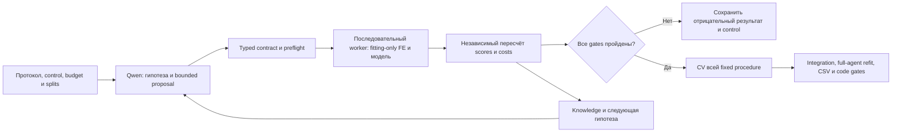

# Qwen MVP и autoresearch: проверенные результаты и следующие решения

Статус на промежуточном checkpoint23Oct: полный MVP завершён; независимые
regression screens и classification FE-01/HPO-01 завершены. Classification
HAR-01 и отдельный FE-02 followup ещё выполняются/ожидают; их результатов здесь пока нет.
Отдельный fixed BLEND-01 replay прошёл оба cuts; его grouped CV подготовлен,
ещё не запущен. Replay не меняет qualified status.
Лучший qualified полный агент остаётся V11/V16. Official uploads не делались.

## Полный MVP

Эксперимент явно включает staged Qwen, CatBoost top32 и inner Optuna8 при
неизменной общей границе10800s на два публичных tasks. Это одновременная смена
нескольких факторов; нельзя приписывать весь результат одному компоненту.
Независимо проверены фактические сохранённые partitions, исходные labels,
метрики по predictions, оба полных refits, итоговые CSV и integrity.

|Полная процедура|Macro F1, mean двух cuts ↑|RMSE, mean двух cuts ↓|
|---|---:|---:|
|Qualified V11/V16|.6593178433614652|35.44723155783769|
|Четырёхэтапный MVP|.6544845346080569|36.02469255996805|
|MVP минус control|−.004833308753408261|+.577461002130363|

Receipt: [mvp01_complete_20261023.json](mvp01_complete_20261023.json).
Фактическое совпадение четырёх partitions:
[mvp_comparison_partitions_20261023.json](mvp_comparison_partitions_20261023.json).
Это reused-public development, не OOF, private performance или официальные
нормализованные points. Для points отсутствуют hidden baseline/test metrics.

Отдельный REG-BLEND-01 replay с fixed.9complete-control+.1inner-selectedTPE
также прошёл оба cuts: meanRMSE35.39729814378806 против35.44723155783769,
0fits/5.863s. [Receipt](reg_blend01_replay_20261023.json),
[протокол трёх forward cuts](reg_blend01_cv_protocol_20261023.md).
Это отдельная новая adaptive mixture procedure; standalone HPO-01 остаётся
отрицательным. Qualification ещё не запущена и не означает full OOF.

## Почему обязательные стадии оказались дорогими

MVP classification занял9133.645s. В search записан51 selector fit; эти записи
относятся к разным фактическим fitting scopes, их нельзя заменить одним
selector, обученным на всём outer train. В 900.6s HPO поместились только два
successful trials (412.532s и425.991s), третий завершился timeout. Startup3
не пройден, guided TPE attempts0. Название TPESampler не доказывает, что была
измерена работа его guided phase. Inner gain .00023644 не перенёсся на outer:
conditional selector-on comparison .6502622584→.6490185190.

В конце хватило резерва на full refit, но защита бюджета пропустила весь cached
blend scoring. Posthoc replay тех же пяти canonical mixing configurations
на двух уже сохранённых successful candidates потребовал0 fits: лучший mean
.6572695988152342. Это всё ещё ниже qualified .6593178433614652. Полного refit
этого replayed blend нет; первоначальный результат MVP от replay не меняется.
Receipt: [mvp_cached_blend_replay_20261023.json](mvp_cached_blend_replay_20261023.json).

Другой заранее зафиксированный replay BLEND-01 использует сильный ПОЛНЫЙ
V11/V16 control с весом.9 и готовый MVP SINGLE с весом.1 (одна конфигурация,
без grid). Оба cuts улучшились: .6632403175→.6639909034 и
.6553953693→.6561163362, mean .6600536197705544 против .6593178433614652.
Supported/rarest gates проходят; Worms F1 не меняется. Это новое положительное
наблюдение о дополнении ошибок, а не отмена отрицательного FE-01 и не результат
полного нового агента. Исполнение3.414s/0fits. Receipt:
[blend01_replay_20261023.json](blend01_replay_20261023.json).
До CV записан [протокол](blend01_cv_protocol_20261023.md) всей фиксированной
ensemble procedure с повторным fitting preprocessing/selection/calibration.
Новая mixture weight или другой complement после этих scores не подбираются.

Практическая гипотеза: отдельно резервировать дешёвую обработку готовых
predictions и дорогие model fits; включать FE/HPO только после component gate,
планировать число trials по измеренной стоимости. Это ещё не проверенная новая
полная процедура. Нельзя сокращать protected confirmation/refit reserve ради
дополнительного поиска. Historical timing comparison с selector — observational,
а не изолированный causal overhead estimate.

## Component screens

Здесь controls — сильные ОДИНОЧНЫЕ рецепты. Их means нельзя подменять means
полного V11 ансамбля. Regression uses offsets0/1/2, classification cuts42/43;
одинаковое слово mean не означает одинаковые строки или число cuts.

|Изолированная проверка|Control mean|Candidate mean|Исходный gate|
|---|---:|---:|---|
|Regression CatBoost top32|40.60751094989404|41.37522600161565|FAIL: все3cuts хуже|
|Regression Random8|40.60751094989404|40.76984099011162|Comparator для TPE|
|Regression TPE8|40.60751094989404|40.502667267123364|FAIL: один cut хуже, хотя mean лучше random|
|Regression typed feature DSL|40.60751094989404|41.03555398191205|FAIL: все3cuts хуже|
|Classification CatBoost top32|.6547938868310776|.654200887190105|FAIL: cut42 хуже, cut43 лучше|
|Classification Random8|.6547938868310776|.6512720038256385|FAIL: оба cuts хуже|
|Classification TPE8|.6547938868310776|.6470992370165256|FAIL: оба cuts хуже, mean хуже random|

Classification HPO COMPLETE:8complete trials у каждого sampler на каждом cut,
все4studies/32objectives независимо verified, одинаковые inner partitions.
У каждого TPE5successful trials after startup. На cut42 inner
TPE .6298975660→.6443637404, но outer .6558634660→.6406114277; random outer
.6521687684. На cut43 оба метода тоже хуже control. В inner objective Worms
имеет11validation groups, его F1 .64→.69565; улучшения были также у других
классов. Это повод исследовать устойчивость inner objective, не доказательство
причины loss: Analysis улучшился внутри и заметно ухудшился снаружи. Receipt:
[class_hpo_inner_support_20261023.json](class_hpo_inner_support_20261023.json).

HAR-01 classification generation: по2raw proposals у baseline/staged, по1valid.
Второй у обоих отклонён из-за `feature_views` с изменёнными features. Оба valid
recipes идентичны по signature: тот же two-view control с class_weight_power1.0.
[Generation receipt](har01_generation_20261023.json). Промпты не дали разных
исполнимых идей в этом matched случае. В текущем протоколе ML fits повторяются;
будущий cache по полному source/input/recipe/split fingerprint мог бы избежать
повторного обучения при одинаковом recipe. Пока это гипотеза экономии времени,
не измеренный scheduler gain. Feature-view/typed-row-feature bridge должен
сначала пройти zero-feature parity, затем отдельный feature bundle screen.

HAR-01 regression: baseline и staged получили одинаковый measured feedback,
по два distinct valid предложения. Ни один из четырёх рецептов не улучшил все
три cuts. Это сравнение двух proposal prompts на фиксированном feedback, а не
полных исходных agents. В контексте был первый cut; перенос улучшений на более
старые периоды оказался слабым. Причинный эффект этой неполноты не доказан.
Следующий prompt/tool experiment может одинаково предоставить всем вариантам
полную матрицу periods, сохранив cap и evaluator.

Inventory [selector_feature_inventory_20261023.json](selector_feature_inventory_20261023.json)
показывает, что top32 в encoded view оставляет только13 исходных columns из42
и19 derived columns. В raw view удаляет10 исходных. Это обосновывает FE-02
как проверку другой семантики отбора: raw protected union ordinary top32.
Это не доказывает причину loss или будущий gain. Например, в cut43 selector
не сохранил отдельные Worms TE columns, но итоговый Worms F1 не изменился.

В cut42 supported-class violation — Analysis (695 independent fitting groups,
delta−.011701); Worms46groups не входит в заранее заданный >=100 gate.
Улучшение среднего без Worms недостаточно при loss supported class и overall
loss. FE-02 не должен ослаблять этот gate, даже если средняя метрика вырастет.

В regression HPO обнаружена различная history availability на actual fitting
scopes: часть коротких inner prefixes ещё не имеет трёх периодов, при которых
worker включает историю. [hpo_history_availability_20261023.json](hpo_history_availability_20261023.json).
Это проверенный факт о режиме preprocessing, не установленная причина score.
Availability-aware objective — гипотеза; внешние периоды нельзя давать inner
preprocessing, чтобы искусственно выровнять feature count.

## Изменения исследовательского агента

1. HAR-01 ограничивает число distinct proposals кодом, сохраняет raw generation
   и contract rejection отдельно от ML score. Prompt сам по себе не обеспечивает
   cap и не показывает, сколько идей потеряно при normalizing.
2. HAR-02 использует typed numeric DSL и trusted compiler вместо свободного Python.
   Реальный Qwen выдал пять исполнимых признаков; ML screen отрицателен.
   Успешное исполнение — отдельная характеристика tool, а не качество признаков.
3. FE-02 реализован отдельным trusted worker extension, без смены frozen core.
   Запуск последовательный после общей очереди; критерии записаны до fits.
4. Установлен [autoresearch-ml](../../skills/autoresearch-ml/SKILL.md) на основе
   pinned [Karpathy autoresearch](https://github.com/karpathy/autoresearch/commit/228791fb499afffb54b46200aca536f79142f117).
   Цикл: гипотеза/коммит → ограниченный запуск → независимая оценка → решение →
   журнал. Адаптация использует CPU tabular metrics, fitting-only transforms,
   group/time validation, inner HPO и историю отрицательных commits.
5. Три live Qwen meta-reviews сохранили ограничения самой схемы анализа.
   REVIEW-01 принял envelope, но ошибся в supported gate; critical numeric rule
   не был явно загружен, локальная ссылка не является tool load. REVIEW-02 на
   тех же фактах и skill с явным contract вернул `{}` и был отклонён.
   Усиление валидации защищает coordinator, но улучшения usable model review
   эти два вызова не установили. REVIEW-03 с новыми blend facts дал валидную
   схему/IDs (7091tokens), но неверные Worms mechanism, unit и RMSE direction.
   Formatter тоже упускал явные unit/direction MVP cards; после аудита эти
   поля и signed improvement вычисляет код (5no-fit checks PASS). Эффект
   последней правки на API-ответ не измерен. Не делать общий reliability/A-B
   вывод по N=1.

## Направления после текущих screens

Разработанный исследовательский контур (отдельно от frozen contest runtime):

Стрелка к integration — обязательный следующий gate, не статус уже выполненной
интеграции. Qwen не присваивает qualified status и не меняет контракты.

Приоритет имеют cost-aware scheduling, полный period/class feedback и
conditional feature/HPO activation. Scope-aware кеширование teacher fits можно
изучить только с проверкой полного fingerprint: rows, transformed fitting X,
y, weights, recipe/seed и версии. Равные source row hashes сами по себе не
доказывают одинаковый transformed fit. Нельзя кешировать outer selector для
inner scopes или строить выбор features по validation.

Positive screen потребует предусмотренных grouped CV всей selection procedure
либо forward qualification, затем полного агента на обоих tasks и final CSV.
До этого ни прототип, ни средний выигрыш одного cut не становится release.
Новые learned rules должны иметь receipts; рекомендации Qwen остаются hypotheses.
